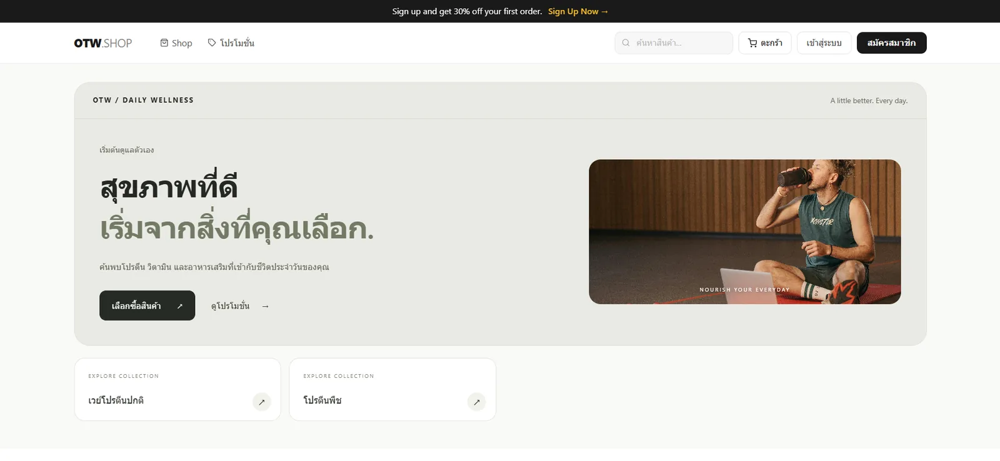
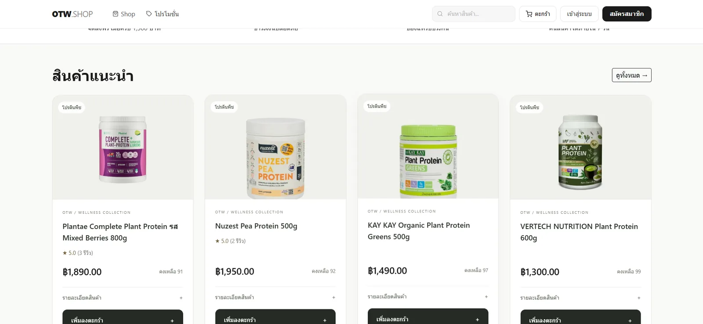
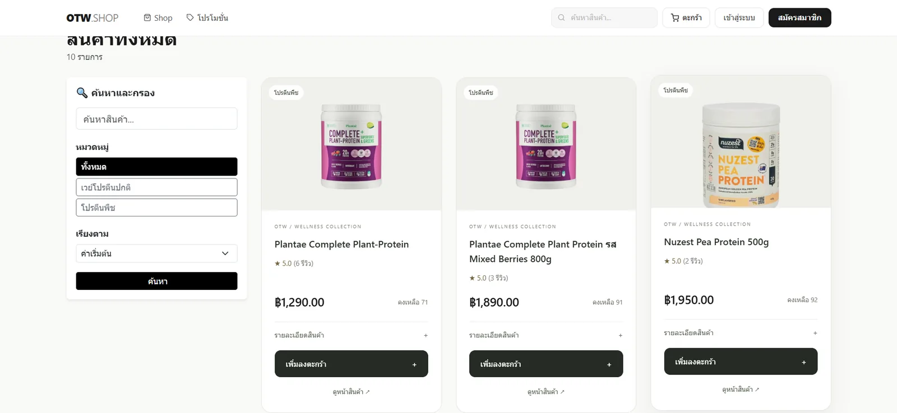
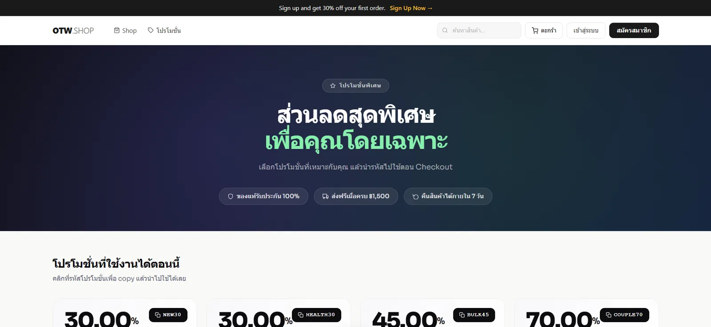
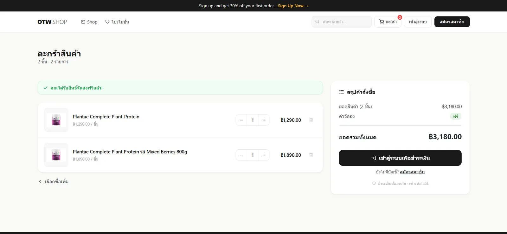
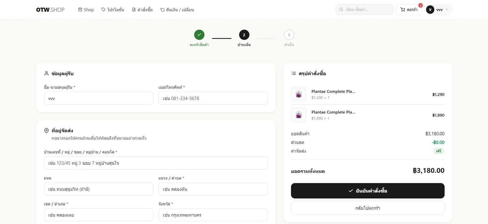
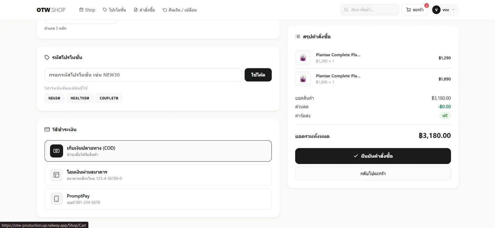
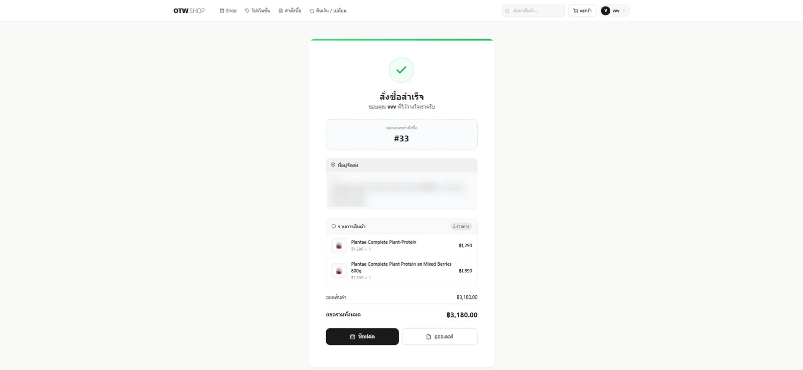
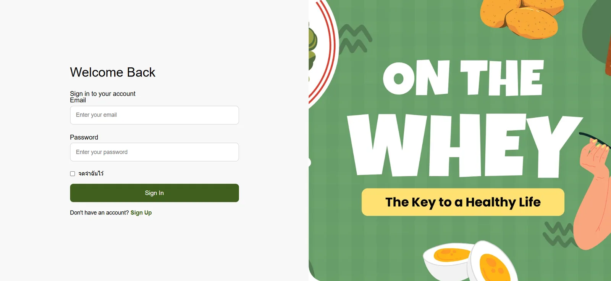

# OTW (On The Whey)

ร้านขายเวย์โปรตีนและโปรตีนพืชออนไลน์ ผมทำโปรเจกต์นี้คนเดียวตอนเรียนปี 2 ด้วย ASP.NET Core MVC กับ MySQL ระบบมีหน้าร้านให้ลูกค้าเลือกซื้อ และหลังร้านให้ Admin จัดการสินค้า ออเดอร์ โปรโมชั่น และคำขอคืนสินค้า

README นี้อธิบายว่าระบบทำอะไรได้ สร้างด้วยอะไร ตอนนั้นผมทำอะไรพลาดไปบ้าง และตอนนี้ระบบอยู่ในสภาพไหน

เว็บที่ deploy อยู่: https://otw-production.up.railway.app



## ภาพหน้าจอ

ภาพทั้งหมดถ่ายจากเว็บที่ deploy บน Railway เมื่อ 18 ต.ค. 2026 ผมเบลอที่อยู่จัดส่งในหน้าสั่งซื้อสำเร็จไว้ ส่วนหลังร้าน Admin ยังไม่มีภาพ

| สินค้าแนะนำหน้าแรก | หน้า Shop |
| :---: | :---: |
|  |  |

| โปรโมชั่น | ตะกร้าสินค้า |
| :---: | :---: |
|  |  |

| Checkout: ข้อมูลผู้รับ | Checkout: โค้ดโปรและวิธีชำระเงิน |
| :---: | :---: |
|  |  |

| สั่งซื้อสำเร็จ | เข้าสู่ระบบ |
| :---: | :---: |
|  |  |

## เทคโนโลยี

| ส่วน | ที่ใช้ |
|---|---|
| Backend | ASP.NET Core MVC (.NET 10), C# |
| ฐานข้อมูล | MySQL ผ่าน Entity Framework Core 9 + Pomelo |
| Frontend | Razor Views, Bootstrap 5, jQuery, CSS เขียนเอง |
| Login | เก็บ `UserId` / `Role` ไว้ใน Session (ไม่ได้ใช้ ASP.NET Identity) |
| Deploy | Dockerfile สำหรับ Railway / Render |

## ฟีเจอร์

### ฝั่งลูกค้า
- ดูสินค้า กรองตามหมวด ค้นหาชื่อ เรียงตามราคาหรือสินค้าใหม่
- หน้ารายละเอียดสินค้า แสดงคะแนนเฉลี่ยจากรีวิว และสินค้าในหมวดเดียวกัน
- ตะกร้าสินค้าเก็บใน Session ส่งฟรีเมื่อซื้อครบ 1,500 บาท ไม่ถึงคิดค่าส่ง 50 บาท
- Checkout กรอกที่อยู่และเลือกโปรโมชั่นที่ตัวเองมีสิทธิ์ใช้
- ดูประวัติออเดอร์และสถานะ (รอดำเนินการ / กำลังจัดส่ง / จัดส่งสำเร็จ / ยกเลิก)
- รีวิวสินค้า 1 ถึง 5 ดาว ได้เฉพาะออเดอร์ที่จัดส่งสำเร็จ และรีวิวได้ครั้งเดียวต่อสินค้าต่อออเดอร์
- ขอคืนเงินหรือเปลี่ยนสินค้าภายใน 7 วัน แนบรูปหลักฐาน JPG/PNG ไม่เกิน 5 MB
- แก้ไขโปรไฟล์ เปลี่ยนรหัสผ่าน อัปโหลดรูปโปรไฟล์

### ฝั่ง Admin
- Dashboard: ยอดขายรวม จำนวนออเดอร์ ลูกค้า สินค้าใกล้หมด (ต่ำกว่า 10 ชิ้น) และงานที่รอจัดการ
- จัดการสินค้า: เพิ่ม แก้ไข ลบ อัปโหลดรูป สลับมุมมองตาราง/การ์ด ค้นหาและกรองสถานะ/สต็อก
- ถ้าสินค้าหรือโปรโมชั่นมีออเดอร์อ้างอิงอยู่ ระบบจะปิดการขายแทนการลบ เพื่อเก็บประวัติออเดอร์ไว้
- จัดการออเดอร์: เปลี่ยนสถานะจากรอดำเนินการ เป็นกำลังจัดส่ง เป็นจัดส่งสำเร็จ
- อนุมัติหรือปฏิเสธคำขอคืน/เปลี่ยนสินค้า
- จัดการสมาชิก: แยกลูกค้าใหม่กับลูกค้าเก่าจากจำนวนออเดอร์

### ระบบโปรโมชั่น
`Helpers/PromotionValidator.cs` ตรวจสิทธิ์ก่อนใช้โค้ดทุกครั้ง โปรหนึ่งตัวกำหนดได้ว่า
- ลดเป็นเปอร์เซ็นต์ หรือลดเป็นจำนวนเงิน
- ยอดซื้อขั้นต่ำ ช่วงวันเริ่มและวันหมดอายุ
- ใครใช้ได้: ทุกคน / ลูกค้าใหม่ที่ยังไม่เคยสั่ง / ลูกค้าเก่า / VIP
- จำนวนครั้งต่อคน และจำนวนครั้งรวมทั้งหมด

ระบบตรวจซ้ำอีกรอบตอนกดสั่งซื้อ เผื่อโปรหมดอายุระหว่างที่ลูกค้ายังอยู่หน้า Checkout

## โครงสร้างโปรเจกต์

```
Controllers/   Home, Shop, Checkout, Account, Review, Return, Admin
Models/Db/     Entity ที่ scaffold จากฐานข้อมูล + Csi402dbbContext
ViewModels/    Login, Register, การ์ดสินค้า, Hero
Helpers/       PromotionValidator, PasswordHelper, UploadStorage
Views/         Razor views แยกตาม controller, _Layout (หน้าร้าน), _AdminLayout
wwwroot/       CSS, JS, รูปสินค้า, ไลบรารี
```

ตารางในฐานข้อมูล: `users`, `categories`, `products`, `orders`, `order_details`, `promotions`, `reviews`, `returns`

ค่าที่เป็นตัวเลขในระบบ

| ฟิลด์ | ค่า |
|---|---|
| `users.role` | 1 = Admin, 2 = ลูกค้า, 3 = VIP |
| `orders.order_status` | 1 = รอดำเนินการ, 2 = กำลังจัดส่ง, 3 = จัดส่งสำเร็จ, 4 = ยกเลิก |
| `returns.status` | 0 = รอตรวจ, 1 = อนุมัติ, 2 = ปฏิเสธ |

## วิธีรัน

ต้องมี .NET 10 SDK และ MySQL ที่มีฐานข้อมูลของโปรเจกต์อยู่แล้ว

1. สร้าง `appsettings.json` (ไฟล์นี้ไม่อยู่ใน git) แล้วใส่ connection string

   ```json
   {
     "ConnectionStrings": {
       "DefaultConnection": "Server=localhost;Port=3306;Database=csi402dbb;User=root;Password=...;"
     }
   }
   ```

2. รัน

   ```bat
   dotnet restore
   dotnet run --launch-profile http
   ```

3. เปิด http://localhost:5071

ไฟล์ที่ผู้ใช้อัปโหลดจะเก็บที่ `wwwroot/uploads` ถ้า deploy ด้วย Docker ให้ mount volume ที่ `/data` เพราะ Dockerfile ตั้ง `Uploads__Path=/data/uploads` ไว้ ถ้าไม่ mount รูปจะหายทุกครั้งที่ deploy ใหม่

รายละเอียดการปรับ UI หน้าร้านและ Admin อยู่ใน [README-UI-UPDATE.md](README-UI-UPDATE.md)

## สิ่งที่ผมทำพลาดตอนปี 2

ผมกลับมาอ่านโค้ดนี้อีกครั้งหลังเรียนผ่านไปแล้ว และเจอข้อผิดพลาดหลายจุด ผมเขียนเก็บไว้ตรงนี้เพราะมันบอกได้ชัดว่าตอนนั้นผมยังไม่รู้อะไร

### ด้านความปลอดภัย
- **เก็บรหัสผ่านเป็นข้อความธรรมดา** ตอน login ผมเขียนเทียบ `u.Password == model.Password` ถ้าฐานข้อมูลหลุด รหัสผ่านของทุกคนหลุดตาม
- **ไม่ป้องกัน CSRF** มีแค่ 2 action ที่เช็ค antiforgery token ปุ่มลบสมาชิก สินค้า และโปรโมชั่นเป็นลิงก์ GET ธรรมดา ถ้า Admin กดลิงก์ที่คนอื่นส่งมา ระบบจะลบ user คนนั้นพร้อมออเดอร์ทั้งหมด
- **ลืมเช็คสิทธิ์ Admin** ใน `AccountController.UserList()` ซึ่งดึงข้อมูล user ทั้งหมดรวมรหัสผ่าน
- **ให้อัปโหลดรูปสินค้าได้ทุกนามสกุล** ใครอัปโหลด `.html` หรือ `.svg` ก็ฝังสคริปต์ลงเว็บได้ (ตอนนั้นผมเช็คนามสกุลแค่ในหน้าคืนสินค้ากับหน้าโปรไฟล์)
- **commit รหัสผ่านฐานข้อมูลลง git** ทั้งใน `appsettings.json` และใน DbContext ที่ scaffold มา ผมลบออกทีหลังแล้ว แต่รหัสยังอยู่ใน git history

### ด้าน logic
- **ใส่จำนวนติดลบลงตะกร้าได้** `AddToCart` ไม่ตรวจ `quantity` ส่ง `-5` เข้าไปจะได้ยอดรวมติดลบ และตอนสั่งซื้อสต็อกกลับเพิ่มขึ้น
- **Checkout ไม่ตรวจสต็อกและไม่มี transaction** ผมลดสต็อกด้วย `Math.Max(0, Stock - qty)` ซึ่งซ่อนปัญหาขายเกินสต็อกไว้ ถ้าสองคนกดสั่งพร้อมกัน โปรก็ถูกใช้เกินโควต้าได้
- **ใช้ราคาจากตะกร้าใน Session** ถ้า Admin เปลี่ยนราคาระหว่างนั้น ลูกค้ายังได้ราคาเก่า
- **เงื่อนไขคืนสินค้า 7 วันมีแค่บนหน้าเว็บ** server ไม่ได้ตรวจ
- **Admin ส่งค่าสถานะอะไรก็ได้** ระบบไม่ได้จำกัดว่าต้องเป็น 1 ถึง 4
- **โปร VIP ใช้ไม่ได้** ผมเขียนเงื่อนไขเช็ค role 3 ไว้ แต่ไม่ได้ทำส่วนที่ตั้งให้ user เป็น VIP
- **มี action ที่ไม่มี view** (`Return/History`) เปิดแล้วเจอหน้า error

### ด้านโครงสร้างโค้ด
- **ส่งข้อมูลไป View ผ่าน `ViewBag` เกือบทุกหน้า** แทนที่จะทำ ViewModel ถ้าพิมพ์ชื่อผิด compiler ไม่เตือน ผมจะรู้ตอนเปิดหน้านั้นเท่านั้น
- **เช็คสิทธิ์ Admin ด้วย `if (!IsAdmin())` ซ้ำทุก action** ถ้าลืมใส่ action ไหน action นั้นก็เปิดโล่ง (ซึ่งเกิดขึ้นจริงกับ `UserList`) ควรใช้ filter หรือ `[Authorize]`
- **ใช้ตัวเลขแทนสถานะและ role** เช่น `Role == 1`, `OrderStatus == 3` กระจายอยู่ทั้ง controller และ view แทนการใช้ enum
- **ทำระบบ login เอง** ด้วย Session แทนการใช้ ASP.NET Identity
- **scaffold DbContext มาสองตัว** (`Csi402dbContext` กับ `Csi402dbbContext`) แต่ใช้จริงตัวเดียว
- **ไม่มีไฟล์ schema หรือ migration** คนอื่น clone ไปแล้วสร้างฐานข้อมูลเองไม่ได้
- **commit รูปที่ลูกค้าอัปโหลดลง git** และเก็บไฟล์อัปโหลดไว้ใน container ทำให้รูปหายทุกครั้งที่ deploy ใหม่
- **ไม่มี test เลย**

## สิ่งที่แก้ไปแล้ว (รอบทบทวน ตุลาคม 2026)

ผมแก้เฉพาะเรื่องที่กระทบความปลอดภัยหรือทำให้ข้อมูลผิด เรื่องโครงสร้างโค้ดผมปล่อยไว้ตามเดิม เพื่อให้งานยังสะท้อนสิ่งที่ทำตอนปี 2

| ปัญหา | ที่แก้ |
|---|---|
| รหัสผ่านไม่ได้ hash | ใช้ `PasswordHasher` ของ ASP.NET Core บัญชีเดิมยัง login ได้ และระบบเปลี่ยนรหัสเป็น hash ให้ตอน login ครั้งถัดไป |
| CSRF | เปิดตรวจ antiforgery token ทุก POST ใน `Program.cs` และเปลี่ยนปุ่มลบเป็นฟอร์ม POST |
| `UserList` ไม่เช็คสิทธิ์ | ลบ action ทิ้ง |
| อัปโหลดรูปสินค้าไม่ตรวจไฟล์ | รับเฉพาะ jpg / jpeg / png / webp ไม่เกิน 5 MB |
| ตะกร้ารับจำนวนติดลบ | จำนวนต้องเป็น 1 ขึ้นไป ไม่เกินสต็อก และสินค้าต้องยังเปิดขาย |
| Checkout ขายเกินสต็อก | ดึงราคาล่าสุดจาก DB ลดสต็อกและนับการใช้โปรด้วย SQL แบบมีเงื่อนไขใน transaction เดียว ถ้าไม่พอระบบยกเลิกทั้งออเดอร์ |
| เงื่อนไข 7 วัน | server ตรวจแล้ว |
| ค่าสถานะ | จำกัดค่าที่รับ |
| `Return/History` | พาไปหน้า `Account/MyReturns` |
| DbContext ซ้ำ | ลบตัวที่ไม่ได้ใช้ |
| ไฟล์อัปโหลด | เลิกเก็บใน git ย้ายที่เก็บไปตั้งค่าได้ผ่าน `Uploads__Path` และเสิร์ฟผ่าน `/uploads/...` |

หลังแก้ ผมเช็คว่า build ผ่าน ทดสอบ `PasswordHelper` กับรหัสผ่านทั้งแบบเก่าและแบบ hash และเปิดแอปจริงเพื่อดูว่าไฟล์ใน `/uploads` โหลดได้ ส่วน flow สั่งซื้อทั้งเส้นผมยังต้องทดสอบด้วยมือกับฐานข้อมูลจริง

## สภาพปัจจุบันและข้อจำกัดที่ยังเหลือ

- ใช้งานได้ครบตามฟีเจอร์ด้านบน ยกเว้นโปร VIP
- รหัสผ่านฐานข้อมูลเก่ายังอยู่ใน git history ต้องเปลี่ยนรหัสที่ตัว MySQL
- ระยะเวลาคืนสินค้า 7 วันนับจากวันสั่งซื้อ เพราะตาราง `orders` ไม่มีคอลัมน์วันที่จัดส่ง
- หน้า Admin ดึงข้อมูลทั้งหมดมาแสดงทีเดียว ยังไม่มีการแบ่งหน้า
- เปลี่ยนรูปสินค้าหรือรูปโปรไฟล์แล้ว ระบบไม่ลบไฟล์เก่า
- ยังใช้ EF Core / Pomelo 9 บน .NET 10
- ยังไม่มี test และยังไม่มีไฟล์ schema ของฐานข้อมูลใน repo

### ปัญหาที่เห็นจากหน้าเว็บจริง

ผมไล่ดูเว็บที่ deploy อยู่ตอนถ่ายภาพหน้าจอ และเจอเรื่องที่ README ข้างบนยังไม่ได้เขียนไว้

- **วิธีชำระเงินมีแค่บนหน้าเว็บ** หน้า Checkout ให้เลือกเก็บเงินปลายทาง โอนผ่านธนาคาร หรือ PromptPay แต่ `CheckoutController.PlaceOrder` ไม่ได้รับค่า `payMethod` ระบบไม่รู้ว่าลูกค้าเลือกจ่ายแบบไหน และไม่มีขั้นตอนแนบสลิปหรือยืนยันการโอน
- **เลขบัญชีและเบอร์ PromptPay เป็นค่าตัวอย่าง** (`123-4-56789-0`, `081-234-5678`) แต่หน้าเว็บแสดงเหมือนข้อมูลจริง ถ้ามีคนโอนตามนั้นเงินจะไปไม่ถึงร้าน
- **หน้าเข้าสู่ระบบและสมัครสมาชิกเป็นภาษาอังกฤษ** ใช้ฟอนต์และสีคนละชุดกับหน้าร้านที่เป็นภาษาไทย แถบประกาศด้านบน "Sign up and get 30% off" ก็เป็นภาษาอังกฤษเหมือนกัน
- **ข้อความใต้หัวข้อหน้าเข้าสู่ระบบติดกับป้าย Email** ไม่มีระยะห่างระหว่าง "Sign in to your account" กับช่องอีเมล
- **ส่วนลดในหน้าโปรโมชั่นแสดงทศนิยม** เช่น `30.00%` และตัวเลขใหญ่จนชนกับป้ายโค้ดโปรด้านขวา
- **หน้า Checkout แสดงบรรทัดส่วนลด `-฿0.00`** แม้ลูกค้ายังไม่ได้ใส่โค้ด

## ถ้าทำใหม่ ผมจะ
- ใช้ ASP.NET Identity แทนการเขียนระบบ login เอง
- ทำ ViewModel ให้ทุกหน้า และใช้ enum แทนตัวเลขสถานะ
- ใช้ EF Core Migrations เพื่อให้คนอื่นสร้างฐานข้อมูลได้จาก repo
- แยก logic การสั่งซื้อออกจาก controller เป็น service แล้วเขียน unit test ครอบ
- คิดเรื่องการกดพร้อมกันหลายคนตั้งแต่ตอนออกแบบ Checkout
